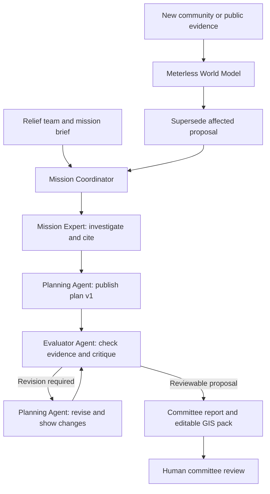
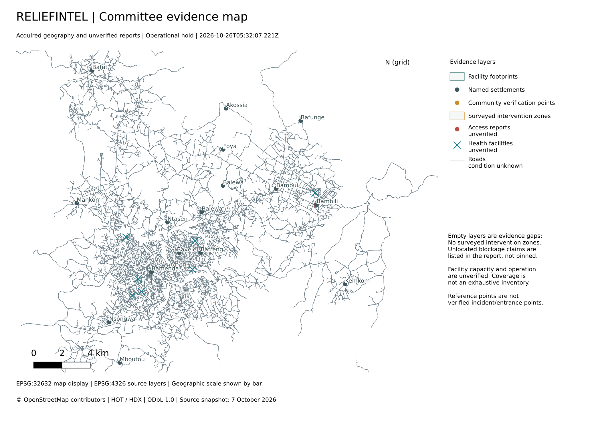

# ReliefIntel

### Mission intelligence for communities in crisis

**ReliefIntel turns fragmented humanitarian information into sourced findings, agent-generated maps and intervention plans that a relief committee can review, challenge and update.**

Built from five years of NGO experience, ReliefIntel addresses the work that happens **before aid moves**: understanding community needs, locating services, assessing access evidence and deciding what limited resources can support. Its initial focus is crisis-affected communities in Cameroon's North-West and South-West; its working demonstration covers the **Bamenda–Bambili corridor**.

**Open Agent Hackathon 2026 · Solving Fragmented Intelligence · Team PortalOne**

[Review the evidence](docs/JUDGE_GUIDE.md) · [Open a generated report](docs/evidence/private-inference-demo-2026-10-26/report.pdf) · [Download a GIS pack](docs/evidence/private-inference-demo-2026-10-26/committee-pack.zip) · [Run the project](#run-reliefintel)

## Why this matters

An NGO's decision to intervene begins long before a vehicle leaves its base. Field observations may be in Kobo, public context in humanitarian updates, stock and fleet information in spreadsheets or operational systems, and roads and facilities in separate map layers. Bringing those pieces together takes research, local knowledge and GIS work.

For a small relief team, that preparation burden competes with the same staff time and resources needed to serve communities. A missing facility detail, an old access report or an unclear location can change an entire proposal.

ReliefIntel gives those teams an investigative capability: ask a mission question, see the evidence being assembled, inspect the resulting geography, and receive a documented proposal with the remaining decisions made explicit.

| What changes for the team | Why it matters for the intervention |
|---|---|
| Reports, community references and logistics are queried together | Planning starts from a shared evidence basis rather than disconnected fragments. |
| Agents construct the map and export editable layers | Teams gain usable geography without manually assembling every layer in QGIS. |
| Proposals are challenged against their evidence and resource constraints | Vehicles, fuel, supplies and timing can be considered together before commitment. |
| New evidence can supersede a proposal and trigger fresh review | A committee can see when its earlier decision basis has changed. |
| Unknowns remain attached to the findings and deliverables | Field teams can distinguish what is known from what must still be confirmed. |

**The intended community impact is better-targeted, better-coordinated and better-prepared humanitarian intervention.** The hackathon demonstrates the working preparation workflow; deployment outcomes and time savings have not yet been measured in an NGO pilot.

## One conversation. An investigative team.

The user works with a **Mission Coordinator**, which clarifies the brief and delegates to specialists. Users do not select agents manually.

**Try another case:** click **New mission** above the conversation. Each mission keeps separate messages, requirements, investigation runs and documents. **Mission history** reopens earlier work, and the selected mission has a reloadable URL. Creating a mission preserves previous work and stops its old watch; an active investigation must finish first. A new case can start with a greeting and clarification. Geography beyond the acquired corridor remains an explicit coverage gap.



1. **Clarify the mission.** Capture area, beneficiaries, cargo, resources, timing and operating policy. A greeting starts a conversation; missing inputs prompt specific questions.
2. **Investigate.** Collect eligible community reports and public context, reconcile locations and query the federated evidence. Findings carry traceable citations.
3. **Construct the geography.** Tools assemble roads, facility references, reported constraints and a source-backed route candidate. Ambiguous places remain ambiguous.
4. **Publish before evaluating.** The Planning Agent makes v1 available before the Evaluator starts. Critiques, subsequent versions and actual text diffs remain inspectable.
5. **Deliver a committee dossier.** Produce the narrative report, map atlas, source register, coordinate inventories and editable GIS files.
6. **Respond to changed evidence.** During an enabled watch, relevant source changes withdraw the old proposal's current status and commission a replacement investigation. Earlier documents remain historical snapshots.

**The differentiator is the complete loop: investigate → map → propose → critique → revise → reassess when the evidence changes.** A useful result includes the map and decision documents, not just an answer in chat.

## The agents make the map

ReliefIntel generates geography through tools over acquired source data. Its mapped route follows connected road vertices; the language model does not invent a line between locations.

The current atlas includes **11 distinct layers**: roads, possible report-to-road matches, mission route, origin/destination references, administrative boundaries, health facilities, reported access observations, surveyed intervention zones, community verification candidates, settlements and facility footprints.

The acquired corridor contains **5,100 road line features, seven mapped health features and 16 settlement references**. These are source inventory counts, not a claim of exhaustive or currently operational coverage. [Inspect the source manifest](data/community-map-v1/manifest.json).

<p align="center">
  <a href="docs/evidence/private-inference-demo-2026-10-26/committee-pack.zip"></a>
</p>

*Actual map from the published 26 October demonstration pack. This historical seven-layer export predates the current route-focused eleven-layer atlas. [Image provenance](docs/assets/readme/source.json) · [Current cartography](docs/MAP_CARTOGRAPHY.md).*

The current browser map has a white-cased route, A/B references, distinct facility and report symbols, layer controls, mission/coverage framing, north indicator, scale and attribution. The A3 export adds coordinate ticks, a regional locator, keyed health inventory and a saved QGIS print layout.

| Committee output | What the team receives |
|---|---|
| Cited PDF report | Situation summary, findings, recommended interventions, resource calculations, risks, evidence trail and next steps. |
| Vector map PDF | A framed atlas with symbology, legend, scale, coordinates, source dates and attribution. |
| GeoPackage and GeoJSON | Editable geodata with separate meanings for roads, facilities, reported constraints and intervention references. |
| Native QGIS project and QML styles | Relative layer paths and saved styling/layout for a GIS handoff. |
| Source register and draft history | Evidence references, versions, critiques, changes and file checksums. |

The exporter writes and reopens layers, checks feature counts, CRS and geometry, and validates the relocated QGIS handoff. A failed export remains visible and cannot become a ready download. [Export implementation](src/lib/server/committee-export.ts) · [Native QGIS renderer](scripts/export-qgis.py).

## Why the sponsor technologies belong in this product

### Zetaris: resolve fragmentation before model reasoning

Zetaris is the data layer. It joins report projections, community references and registered logistics, applying filters and aggregation before passing a bounded answer set to the agents. This is the project's **Token Firewall pattern**: resolve the structured data question in the engine before spending model context on it.

**This data-querying layer is foundational to ReliefIntel's promise.** The product must reconcile fragmented evidence before it can produce a defensible intervention proposal. In live mode, removing Zetaris makes the federated assessment unavailable; the application exposes that gap. It cannot replace the missing answer with model guesses.

Kobo metadata is projected into a dedicated queryable schema. Narrative interpretation follows a separate, operator-authorized processing contract. Separate planner/checker queries and source revisions make the basis inspectable. Public humanitarian context is retrieved separately and retains its own provenance.

[Data adapter](src/lib/server/zetaris.ts) · [Community evidence](src/lib/server/community-evidence.ts) · [Federation design and live proof](docs/FEDERATED_PLANNING.md).

**Zetaris evaluation proof:** a deployed USL with **four active tables over three logical registered sources**, checked-in DDL, **six exploratory queries**, **three USL verification queries** and **two executed custom data-quality rules**. The freshness rule rejects expired access options. [Scoring evidence, reflection and PM proposal](docs/ZETARIS_SCORING.md) · [DDL](data/zetaris-usl-v1/model.sql) · [Actual engine receipt](docs/evidence/zetaris-usl-2026-10-27.json). This public proof uses public community references and synthetic logistics/access data; the application's private-report adapter retains its existing bounded source-level SQL.

### Meterless: inference routing and evidence-dependent memory

**Nightshift is the application's AI provider path.** Streaming committee calls use explicitly discovered NVIDIA model identities and retain model/stream receipts. The app forwards actual provider content deltas; it does not animate a saved final answer to imitate generation.

**World Model is a working product feature.** It tracks observations and proposal assumptions. Changed evidence can invalidate an affected proposal, preserve the old documents and trigger a replacement mission. Its pinned implementation passes eight conformance checks, including provenance, idempotency, bitemporal history and audit ordering.

[Provider adapter](src/lib/server/meterless.ts) · [Mission dependencies](src/lib/server/mission-world.ts) · [Pinned World Model](vendor/meterless-world-model) · [Changed-evidence proof](docs/evidence/mission-update-2026-10-25.json).

### NVIDIA Nemotron: the investigation and review engine

Nemotron generates coordinator responses, sourced findings, plans, critiques and the final narrative through Nightshift. Model identities and usage are recorded per call. Structured tools perform SQL, geometry, constraint calculations, citation resolution and export; a model cannot turn unsupported text into a verified fact or authorize dispatch.

The technologies carry distinct, necessary responsibilities in this implementation: **Zetaris resolves the evidence, Nightshift routes the model calls, Nemotron performs the investigative and narrative work, and World Model tracks whether a proposal's assumptions still hold.** Without the configured inference path, live agent writing cannot complete. Without evidence-dependent invalidation, an earlier proposal could outlive the facts on which it depended.

[Committee graph](src/lib/server/committee-mission.ts) · [Mission feasibility](src/lib/server/mission-feasibility.ts) · [Model and streaming contracts](docs/COMMITTEE_WORKFLOW.md).

## Inspect the proof

The repository contains **real sponsor-call receipts and generated artifacts**, alongside an explicitly separate offline replay.

| What to verify | Evidence to open |
|---|---|
| Real Zetaris joins over distinct registered sources | [Federation receipt](docs/evidence/relief-data-2026-10-24.json) and [community-change receipt](docs/evidence/federated-live-change-2026-10-25.json). |
| Active Zetaris semantic tables, DDL, exploration and executed quality rules | [Evaluation guide](docs/ZETARIS_SCORING.md), [USL receipt](docs/evidence/zetaris-usl-2026-10-27.json) and [manual comparison](docs/evidence/zetaris-usl-comparison-2026-10-27.json). |
| A conversational coordinator that clarifies before delegation | [Conversation proof](docs/evidence/coordinator-conversation-2026-10-25.json). |
| Plan v1 before evaluation, critique, v2 and an actual diff | [Live committee receipt](docs/evidence/committee-workflow-2026-10-25.json). |
| New Kobo evidence superseding an earlier plan and triggering a replacement | [Live update receipt](docs/evidence/mission-update-2026-10-25.json) and [replacement PDF](docs/evidence/mission-update-demo-2026-10-25/report.pdf). |
| Model-backed report interpretation with explicit assertion categories | [Interpretation receipt](docs/evidence/report-interpretation-2026-10-26.json). |
| A downloadable, native GIS/report handoff | [Published PDF](docs/evidence/private-inference-demo-2026-10-26/report.pdf), [GIS ZIP](docs/evidence/private-inference-demo-2026-10-26/committee-pack.zip) and [validation receipt](docs/evidence/private-inference-2026-10-26.json). |
| The later integrated mission-input, route, review and restart path | [Local acceptance record](docs/GOAL_1_TO_4.md), [mission requirements](src/lib/server/mission-requirements.ts) and [feasibility checks](src/lib/server/mission-feasibility.ts). |

**Recorded code gate at [`2d63387`](https://github.com/Orielanalyst/PortalOne/commit/2d63387): 180 tests in 23 files, typecheck, production build, eight World Model checks, 154 vendored archive checks, four report-wheel checks and both HTTP-disabled replays passed locally.** The committed source was also checked independently of the parallel UI redesign. The last inspected hosted Actions runs were blocked before execution by an account billing lock; no hosted green result is claimed.

Receipts identify their source commits and dates. The public downloadable snapshots are historical rehearsals and do not silently become the latest run. The prepared HackOS materials include a **2:46 recorded product walkthrough** and **10-slide pitch deck**.

## Run ReliefIntel

### 1. Review the workflow without credentials

Use a recent Bun runtime; the audited workstation uses **Bun 1.4.4 and Node.js 24**. From a fresh clone in PowerShell:

```powershell
git clone https://github.com/Orielanalyst/PortalOne.git
cd PortalOne
git switch codex/execution-readiness
bun install --frozen-lockfile
$env:RELIEFINTEL_MODE = "offline-replay"
bun run dev --host 127.0.0.1 --port 8081
```

Open `http://127.0.0.1:8081`. **OFFLINE REPLAY** is labelled in the interface. This mode uses synthetic fixtures and deterministic orchestration; it makes no live intake or model calls. There is no silent fallback from live generation to replay.

```powershell
bun run check:offline-replay
bun run check:mission-replay
```

### 2. Connect the real services

The live path requires the local Zetaris platform and owned source database, Meterless Nightshift configured with NVIDIA access, and your own Kobo project. Use the supplied sponsor runtimes; proprietary platform bundles and credentials are not redistributed in this repository.

Create `.env` from [`.env.example`](.env.example) on a fresh setup, retaining any existing configuration. Set the Zetaris connection, Nightshift base URL/token and Kobo server/project/token. **The NVIDIA key is saved in Nightshift's Providers settings.** Private report-text processing requires the operator's own scoped authorization; see [the processing contract](docs/PRIVATE_REPORT_PROCESSING.md).

Provisioning commands print their plan first; `--apply` creates/reuses the project's owned resources. For a new Kobo project, add the setup/deploy steps in [live intake](docs/LIVE_INTAKE.md).

```powershell
bun run prepare:relief-data
bun run provision:relief-data
bun run provision:relief-data --apply
bun run check:relief-data
bun run provision:community-data
bun run provision:community-data --apply
bun run check:community-data
bun run check:kobo
bun run check:meterless --infer
```

For PDF/GIS export on the audited Windows host, install CPython **3.12 x64**, then configure the retained report wheels and cache the pinned official QGIS image:

```powershell
./scripts/setup-report-runtime.ps1 -Python (Get-Command python).Source
docker pull qgis/qgis@sha256:bacafbaf899bb2af5d99dd8a138e0438733aac252ddd5f29d089ad34641bb059
bun run check:report-assets
$env:RELIEFINTEL_MODE = "live"
bun run dev --host 127.0.0.1 --port 8081
```

Other operating systems require matching report wheels. Full environment, registration and report instructions are in [the environment guide](docs/ENVIRONMENT.md), [community federation](docs/FEDERATED_PLANNING.md) and [committee workflow](docs/COMMITTEE_WORKFLOW.md). A fresh dependency installation needs registry access; retained archives are inspection/recovery assets, not a universal offline installer.

### 3. Give the coordinator a mission

> I am preparing a demonstration relief mission from Bamenda to Bambili for 200 people. Map health facilities and the corridor, investigate the available evidence, and help me prepare a committee proposal with evaluator review and an editable GIS pack. Ask me for the cargo, resource and timing details you still need.

Answer the coordinator's questions, then request the investigation. Follow **Activity → Map → Evidence → Plan → Report**. Inspect a citation, open the initial proposal, read the evaluator's critique and compare the revision. Enable the bounded watch to test fresh report handling with your own labelled Kobo demonstration.

## Verify the build

```powershell
bun run typecheck
bun run test
bun run check:world-model
bun run check:vendor
bun run check:report-assets
bun run check:offline-replay
bun run check:mission-replay
bun run build
```

Use `bun run demo:relief-agent --live` only with configured services; it makes actual sponsor calls. The core CLI's initial overweight proposal is a declared stress-test fixture. Offline enumeration and live model output are recorded separately. Optional local hooks: `powershell -File scripts/setup-hooks.ps1`.

## Operational scope and next proof

The implemented demonstration is one acquired corridor. Report/logistics rehearsals are labelled synthetic; mapped health features do not establish capacity or current operation, and route geometry does not establish passability. Unlocated reports remain unlocated; unsurveyed intervention zones remain empty. Committee approval applies to an exact proposal and retains field/endpoint holds—it does not authorize travel.

The watch is a bounded local-process feature. Restart preserves history and requires fresh review; it is not a durable month-long field collection service. Publisher failures and source gaps remain visible. WhatsApp/SMS/Telegram intake, broad regional coverage and satellite analysis are future extensions, not connected features claimed here.

**The next proof is a supervised NGO pilot:** measure preparation time, evidence coverage, map corrections and committee usability against the existing workflow, while validating local reporting and operational handoffs.

## Stack, provenance and accountability

**Application:** TypeScript, React, TanStack Start, Bun, LangGraph, Zod, Streamdown/SSE, SQLite, Leaflet, Turf and ngraph. **Data and models:** Zetaris, PostgreSQL, KoboToolbox, public humanitarian feeds, Meterless Nightshift/World Model and NVIDIA Nemotron. **Geospatial/reporting:** attributed OpenStreetMap/HOT–HDX data, geoBoundaries, native QGIS and pinned Python report dependencies.

The concept and visual direction draw on an earlier reference prototype; its commits are not reused. The current repository began on 23 October within the build window. [Provenance](docs/PROVENANCE.md) separates the baseline, new work and acquired components; [AI usage](docs/AI_USAGE.md) records assistance. OpenStreetMap data retain ODbL attribution; the acquired administrative reference retains CC BY 4.0. Package/archive and report-wheel manifests retain dependency licenses. Proprietary sponsor runtimes remain external; no blanket license over third-party components is implied.

[Judge guide](docs/JUDGE_GUIDE.md) · [Acceptance record](docs/GOAL_1_TO_4.md) · [Build log](docs/BUILD_LOG.md) · [Commit policy](docs/COMMIT_POLICY.md) · [Architecture decisions](docs/adr)

**ReliefIntel. Give it a mission.**
