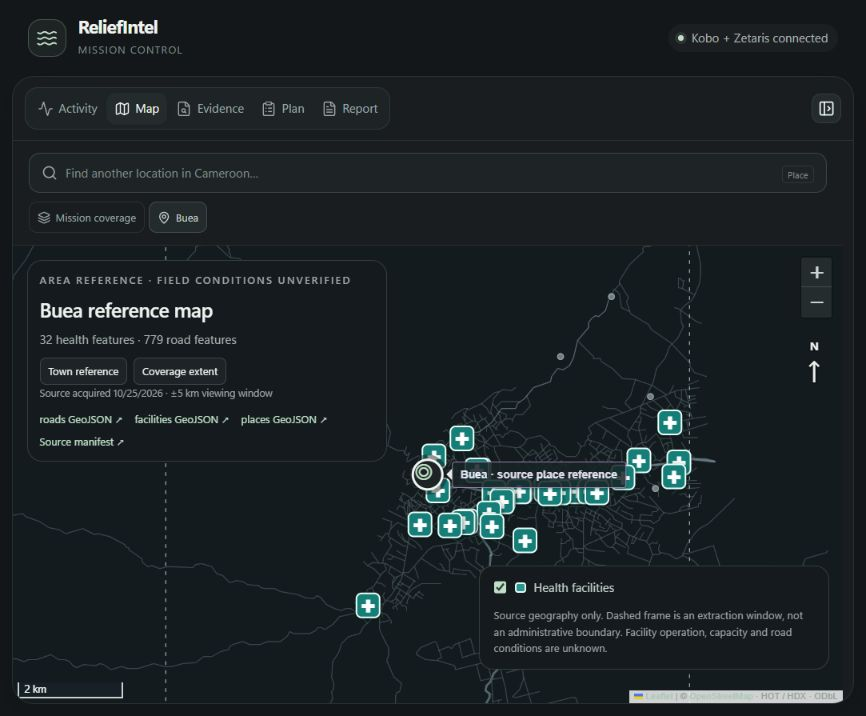

# Area mapping and workspace polish

The workspace keeps its dark palette and adds rounded floating panels, a clearer type scale, a focused map view, source-aware location search and observable loading states. The coordinator's first text now replaces the waiting state immediately, even while its conversation turn remains pending.



*Actual local interface and public reference geography, not a design mockup. [Mapping, model and QGIS receipt](evidence/area-mapping-2026-10-27.json).*

## Try an area

Ask the coordinator: **“Map the health facilities and roads around Buea, Cameroon.”** It delegates a reference-geography task, exposes the Mapping Agent's steps and opens the resulting map. Alternatively, open **Map**, search **Find a Cameroon location**, and select a source match. The expand-workspace button gives the map more room; **Show conversation** restores the split view.

The public source gazetteer contains **12,730 named settlement references**. The local indexes contain **305,926 road lines and 2,108 health features** from the already acquired, hash-pinned HOT/HDX OpenStreetMap archives. A map uses a **±5 km viewing window** around a source reference. Whole intersecting features are retained. This window is not a surveyed intervention or administrative boundary.

The source acquisition date remains visible. Every map retains its public source URLs, attribution, counts and GeoJSON hashes. Downloads provide separate roads, facilities and places GeoJSON plus the source manifest.

## Actual checks

| Reference extract | Road features | Health features | Settlement references |
|---|---:|---:|---:|
| Buea | 779 | 32 | 10 |
| Limbé | 1,095 | 42 | 9 |

Buea was requested through the live coordinator and delegated to the real tool. Its three exported layers were opened in the existing pinned QGIS runtime with network access disabled: all loaded, matched their expected counts and reported **EPSG:4326**. Limbé was independently extracted from the same pinned sources and has a different extent and feature set.

The gazetteer and both attributed extracts are [retained in the repository](../data/area-geography-v1/README.md), about 2.2 MB together. A clean-cache check reproduced the Buea map and ambiguous Kom matches without network use. Other source-matched locations use the national indexes when present; live mode can prepare them from the pinned archives in a separate process. Changed source bytes, integrity failures and oversized areas produce explicit errors. Offline mode cannot silently download missing geography.

## Ambiguity and coverage

“Kom” matches multiple settlement references in the acquired gazetteer. The tool asks the user to choose; it does not silently select the first coordinates or treat one village point as the wider Kom region. A regional intervention still needs an agreed source boundary or a specific town reference. Unknown names remain gaps, and the location chooser currently covers Cameroon.

Health-feature counts are source geometry counts, not independently verified operating hospitals. Capacity, current operation, road passability, incident location and community needs remain unknown without their own evidence. Switching to an area exploration removes the original mission's route/report overlays. The **Mission coverage** button returns to that investigation's geography.

**Reference mapping beyond the corridor does not extend the connected committee workflow.** The full Kobo/Zetaris investigation, route calculations, committee report and reviewed PDF/GIS pack remain scoped to the acquired Bamenda–Bambili integration. A new reference map is a geography artifact; it is not a completed needs assessment or an operational plan for that area.

## Implementation and reproduction

- [Shared geography types and bounds](../src/lib/area-geography.ts)
- [Pinned archive preparation](../scripts/prepare-area-catalog.ts): reuses `shpjs` and `but-unzip`; no new parser dependency.
- [Area service](../src/lib/server/area-geography.ts): bounded extracts, integrity checks and retained artifact reuse.
- [Local API](../src/routes/api.geography.ts): scoped map downloads and explicit place selection.
- [Runtime handoff](../src/lib/server/mission-runtime.ts): persisted per-conversation map jobs and named steps.
- [Mapping regressions](../src/lib/server/area-geography.test.ts) and [first-text regression](../src/components/coordinator-reply.test.tsx).

Optional national catalog preparation (modern Node with TypeScript stripping, or Bun):

```powershell
bun scripts/prepare-area-catalog.ts
```

The current machine reuses its retained national archives. Fresh installations can view the two bundled reference maps without those archives. Wider live extraction may require approximately 110 MB of pinned source archives and additional disk space for the indexes. Geography uses public map sources, with no private Kobo narratives or reporter GPS copied into these extracts.
